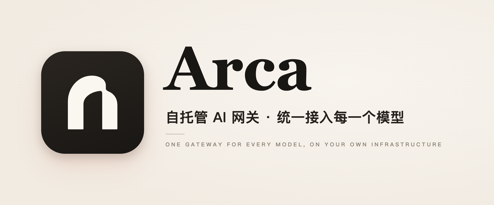
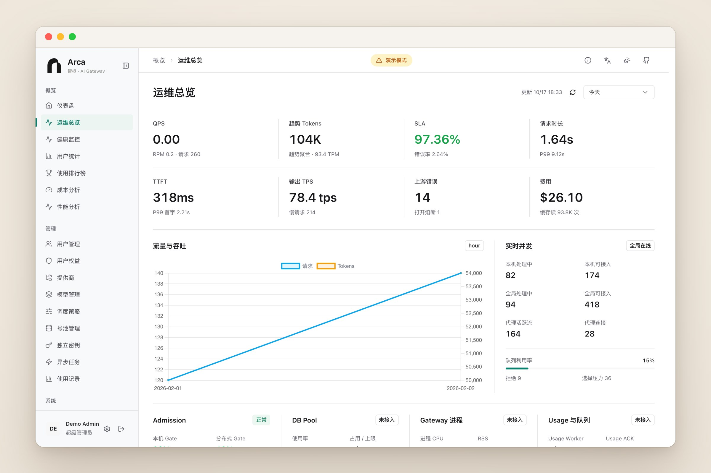
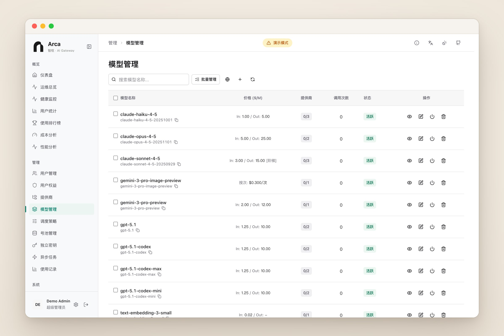
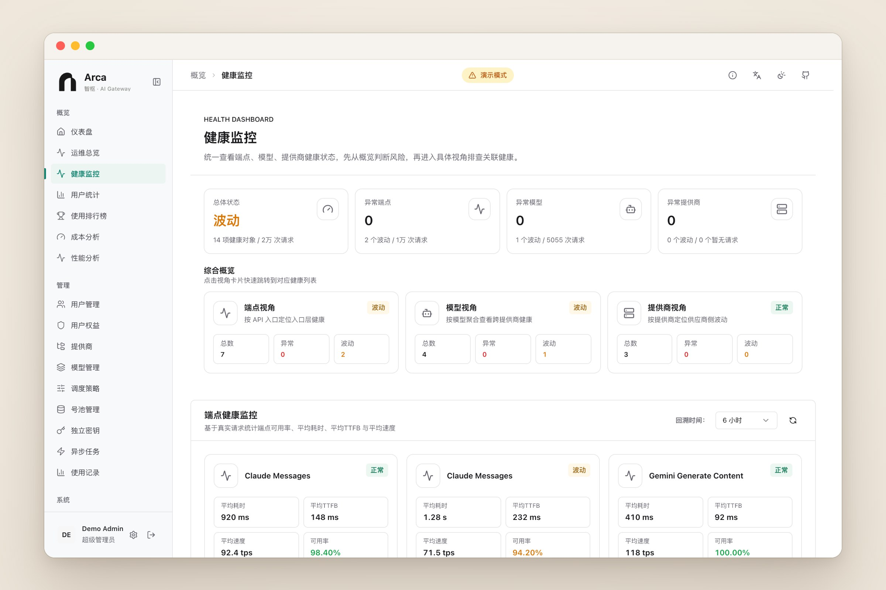
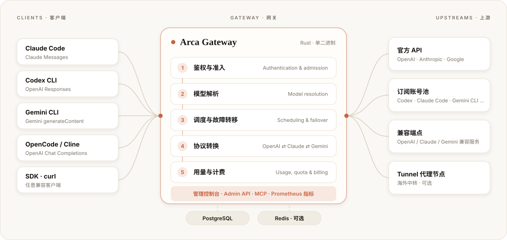

<p align="center">
  <picture>
    <source media="(prefers-color-scheme: dark)" srcset="docs/assets/hero-dark.png" />
    
  </picture>
</p>

<p align="center">
  One entry point for Claude, OpenAI, Gemini and their CLI clients — authentication, conversion, scheduling and quotas, all on your own servers.
</p>

<p align="center">
  
  <a href="LICENSE"></a>
  <a href="https://github.com/Becomingw/Arca/stargazers"></a>
</p>

<p align="center">
  <a href="README.md">中文</a> · <b>English</b> · <a href="docs/configuration.md">Configuration</a> · <a href="docs/ARCA.md">Release notes</a>
</p>

<br />

> **One endpoint, every model.**
> Models now come from many places: official APIs, subscription accounts, third-party compatible services — each with its own protocol, quota and reliability.
> Clients just want the OpenAI, Claude or Gemini interface they already know; operators want one controllable, auditable entry point.
> Arca sits between the two and keeps routing, conversion, limits and metering in one place.

<p align="center">
  
</p>

## Why Arca

<table>
  <tr>
    <td width="33%" valign="top">
      <h3>Protocol-agnostic</h3>
      OpenAI Chat / Responses, Claude Messages and Gemini <code>generateContent</code> are all first-class entry points, with two-way conversion between them covering streaming, tool calls and reasoning content. Same-protocol requests pass through natively.
    </td>
    <td width="33%" valign="top">
      <h3>Reliable and controllable</h3>
      Candidates are ranked by priority, health and cache affinity; failures retry and fail over automatically. Subscription-style upstreams are managed as account pools with live quota and status, and unavailable accounts are dropped automatically.
    </td>
    <td width="33%" valign="top">
      <h3>Self-hosted</h3>
      One Rust binary serves both the API and the frontend. It needs PostgreSQL; Redis is optional. Data and keys stay in your own environment — generated and held by you.
    </td>
  </tr>
</table>

## Features

### Unified access and protocol conversion

- **Multiple protocol entry points**: OpenAI Chat / Responses / Realtime, Claude Messages, Gemini `generateContent`, plus Embeddings, Rerank, image and video tasks, and Gemini Files.
- **Two-way conversion**: requests and responses convert between OpenAI, Claude and Gemini; the conversion contract and field coverage matrix are published in [docs/api](docs/api/).
- **Per-model interface restriction**: restrict a model mapping to specific interface types and endpoints — for example, make an upstream model use only the native Gemini interface and bypass an incomplete compatibility layer.
- **Model catalog and mappings**: global models are decoupled from each provider's real model names, with aliases, tiered pricing and model directives.

### Scheduling and reliability

- **Intelligent routing**: priority, health and cache affinity decide the candidate order; same-protocol candidates come first.
- **Failover**: upstream failures retry and switch candidates automatically; client-disconnect behavior is configurable per strategy. See [routing and failover](docs/operations/routing-failover.md).
- **Account pools**: pools for subscription-style upstreams track quota and health and drop unavailable accounts.
- **Health monitoring**: availability, latency, time to first token and speed from endpoint, model and provider perspectives.

<p align="center">
  
  
</p>

### Multi-tenancy, quotas and cost

- **Users, groups and API keys** with per-model grants, IP allow/deny lists and audit logs.
- **Quotas**: rolling and calendar request caps and shared monthly cost budgets; users without an allocation are denied by default. See [internal gateway mode](docs/operations/internal-gateway.md).
- **Wallets and billing**: billing plans, wallets, referral rewards and payment gateways, plus cost and cache-savings analysis.

### Operations and integrations

- **Admin console**: providers and endpoints, models, routing strategies, users and keys, usage and cost, system settings; Chinese and English UI.
- **Admin MCP**: a built-in `/mcp` endpoint using user-bound admin keys, with preview-and-confirm for writes. See [Agent MCP](docs/operations/agent-mcp.md).
- **One-step Linux setup**: generate a one-time command on the API keys page to configure Codex CLI / Claude Code on a server. See the [setup guide](docs/operations/linux-client-setup.md).
- **Tunnel proxy node**: deployed on an overseas VPS to relay outbound traffic. See the [Tunnel docs](apps/aether-tunnel/README.md).
- **Observability**: per-request usage and timing, request diagnostics, request body viewer, Prometheus metrics.

### Security

- Upstream credentials and sensitive settings are stored encrypted; backups use an encrypted format with key identifiers and support [offline restore](docs/configuration.md#s3-备份离线恢复).
- Body-size and concurrency budgets, outbound DNS and proxy policy, PII redaction and restoration, LDAP and OAuth sign-in.

## Architecture

<p align="center">
  <picture>
    <source media="(prefers-color-scheme: dark)" srcset="docs/architecture/architecture-dark.svg" />
    
  </picture>
</p>

A request passes through: authentication and admission → model resolution → candidate selection and failover → protocol conversion (if needed) → usage and billing. Besides official APIs, the gateway ships provider templates for `codex`, `claude_code`, `gemini_cli`, `antigravity`, `vertex_ai`, `kiro`, `chatgpt_web`, `grok`, `windsurf` and `opencode_go`, and supports any OpenAI-, Claude- or Gemini-compatible custom endpoint.

## Quick start

Arca does **not yet publish prebuilt images or release artifacts**, so you build it yourself. You need Docker and Docker Compose; the repository's Compose files start PostgreSQL and Redis for you.

```bash
# 1. Get the code and build the image
git clone https://github.com/Becomingw/Arca.git
cd Arca
docker build --build-arg AETHER_BUILD_VERSION=arca-dev \
  -f Dockerfile.app.local -t arca:local .

# 2. Configure: generate independent random secrets, set ADMIN_PASSWORD and APP_IMAGE=arca:local
cp .env.example .env && chmod 600 .env
./generate_keys.sh

# 3. Start
docker compose up -d
```

Open `http://localhost:8084`, sign in with `ADMIN_USERNAME` / `ADMIN_PASSWORD` from `.env`, then add providers, models and API keys. When upgrading, do not replace the generated secrets; the database schema migrates automatically on start, and `make db-status` lets you inspect it first.

More: [configuration reference](docs/configuration.md) (Chinese) · [release notes and building your own image](docs/ARCA.md) · [Linux client setup](docs/operations/linux-client-setup.md).

<details>
<summary><b>Want to see the UI first? Frontend demo mode</b></summary>
<br />

The frontend ships with mock data, so you can browse the admin console without a backend:

```bash
cd frontend
npm ci
VITE_DEMO_MODE=true npm run dev
```

Open the address printed in the terminal, sign out of the default demo user, then sign in as `admin@demo.arca.io` / `demo123` for the administrator view. All data is simulated and no real calls are made.

</details>

## Documentation

| Topic | Documents |
| --- | --- |
| Configuration, environment variables, S3 backup restore | [docs/configuration.md](docs/configuration.md) (Chinese) |
| Release notes and building your own image | [docs/ARCA.md](docs/ARCA.md) |
| Internal gateway mode · admin MCP · routing and failover | [internal-gateway](docs/operations/internal-gateway.md) · [agent-mcp](docs/operations/agent-mcp.md) · [routing-failover](docs/operations/routing-failover.md) |
| Model compatibility testing · request diagnostics | [model-compatibility](docs/operations/model-compatibility.md) · [request-diagnostics](docs/operations/request-diagnostics.md) |
| Protocols: Embeddings · Rerank · Responses WebSocket | [embeddings](docs/api/embeddings.md) · [rerank](docs/api/rerank.md) · [WebSocket-Mode](docs/WebSocket-Mode.md) |
| Format conversion contract and coverage | [passthrough contract](docs/api/format-passthrough-contract.md) · [field matrix](docs/api/format-field-coverage-matrix.md) · [interface definitions](docs/api/provider-interface-definitions.md) |
| Runbooks | [Redis runtime](docs/operations/redis-runtime-runbook.md) · [TLS fingerprint](docs/operations/tls-fingerprint-capture.md) · [all](docs/operations/) |

## Development

<p>
  
  
  
  
</p>

```bash
make dev            # backend + frontend Vite dev server; starts Postgres/Redis if missing
make dev-backend    # backend only
make dev-frontend   # frontend only
make db-status      # show database migration status
```

```text
arca/
├── apps/
│   ├── aether-gateway/   gateway binary: HTTP/WebSocket entry, scheduling, admin API, built-in MCP
│   └── aether-tunnel/    Tunnel proxy node
├── crates/               domain libraries: protocol formats, scheduling, data, billing, usage, OAuth, runtime
├── frontend/             admin console (Vue 3 + TypeScript + Vite)
├── deploy/               Compose variants, acceptance scripts and compatibility templates
└── docs/                 protocol notes, runbooks and audits
```

> Directory and crate names keep the `aether-*` prefix inherited from upstream; renaming would break existing deployments, so it is not done for now. Configuration uses the `ARCA_` prefix; legacy `AETHER_*` / `AFSSR_*` names still work and print a deprecation warning.

See [CONTRIBUTING.md](CONTRIBUTING.md) (Chinese) for the development setup, checks and test commands.

## Contributing

Issues and pull requests are welcome. For larger changes, please open an issue first to align on direction; run the checks listed in CONTRIBUTING before submitting and keep changes focused.

## License and acknowledgements

Arca is a downstream fork of [Aether](https://github.com/fawney19/Aether) and keeps its [non-commercial license](LICENSE); the original authors' and contributors' copyright and attribution are preserved. This repository is not an official Aether release, and renaming does not change the license terms.

<p align="center">
  <a href="https://www.star-history.com/#Becomingw/Arca&Date">
    
  </a>
</p>
