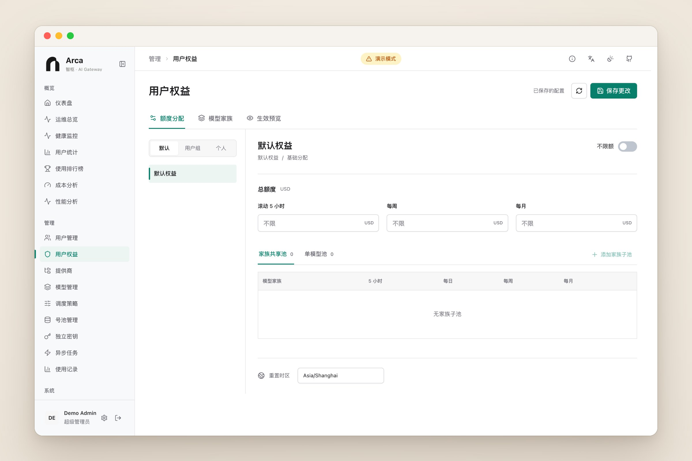

<p align="center">
  <picture>
    <source media="(prefers-color-scheme: dark)" srcset="docs/assets/hero-dark.png" />
    
  </picture>
</p>

<p align="center">
  一个入口接入 Claude、OpenAI、Gemini；额度按用户和用户组分配，日常运维交给反馈与你的 Agent。
</p>

<p align="center">
  
  <a href="LICENSE"></a>
  <a href="https://github.com/Becomingw/Arca/stargazers"></a>
</p>

<p align="center">
  <b>中文</b> · <a href="README.en.md">English</a> · <a href="docs/configuration.md">配置</a> · <a href="docs/ARCA.md">版本说明</a>
</p>

<br />

> **Quotas for people, operations for agents.**
> 团队内部用 AI，缺的不是收银台，而是三件事：谁能用哪些模型、一个月最多花多少、出了问题谁来看。
> Arca 去掉了充值与支付，把额度落到用户和用户组；再让用户反馈、管理 MCP 和你自己的 Agent 接手日常排查与维护。

<p align="center">
  
</p>

## 为什么是 Arca

<table>
  <tr>
    <td width="33%" valign="top">
      <h3>没有商业化，只有额度</h3>
      没有充值、套餐、支付与邀请奖励。管理员按用户和用户组设置美元预算：滚动 5 小时、每周、每月，必要时再细到单个模型。
    </td>
    <td width="33%" valign="top">
      <h3>Agent 参与运维</h3>
      用户在应用里提交反馈，Agent 通过管理 MCP 读取、诊断，并在预览与单次确认之后执行变更。权限始终是「当前用户角色 ∩ Key 范围」。
    </td>
    <td width="33%" valign="top">
      <h3>协议无关，稳定可控</h3>
      客户端使用 OpenAI Responses、Claude Messages 或 OpenAI Chat，网关负责转换并调度到任意上游，失败时自动重试与切换。
    </td>
  </tr>
</table>

## 与 Aether 的不同

Arca 源自 [Aether](https://github.com/fawney19/Aether)，两者在定位上刻意不同：

| | Aether | Arca |
| --- | --- | --- |
| 使用场景 | 内置商业化能力，可对外运营 | 团队内部使用，管理员统一分配额度 |
| 额度模型 | 钱包余额、套餐与付费日额度 | 用户组与个人的美元预算，可按模型家族或单模型设子池 |
| 支付与计费 | 充值、退款、兑换码、套餐购买、邀请奖励、支付网关 | 已移除，相关接口在内部模式下返回 404；仍记录上游成本与用量用于核算 |
| 运维方式 | 在控制台手动操作 | 用户反馈 + 管理 MCP，Agent 在权限、预览与确认的约束下协助 |
| 客户端协议 | OpenAI、Claude、Gemini 多种入口 | 以 OpenAI Responses（含 Codex）、Claude Messages、OpenAI Chat 为主；Gemini 原生接口作为上游适配 |

> 已有的历史财务数据不会被删除或迁移，内部请求只是不再扣费。细节见 [内部网关模式](docs/operations/internal-gateway.md)。

## 功能

### 用户分组限额

- **美元预算**：每个用户组和个人都可以设置滚动 5 小时、每周、每月的总额度，并按模型家族或单模型划出子池（可含每日额度）。
- **继承规则明确**：个人配额整体替换所属组的配额；多个组之间，每个时间窗口取较大值；`unlimited` 是显式豁免。
- **授权与额度分离**：额度条目不会授予模型访问权，模型权限在用户和用户组上单独配置。
- **并发安全**：准入与预留在 PostgreSQL 中完成；策略写入带版本检查，过期写入返回 409，不会覆盖他人的修改。

<p align="center">
  
</p>

### 反馈驱动、Agent 辅助的运维

- **用户反馈**：工单式的问题讨论，包含类别、描述、关联模型或请求、公开或私有可见性与追加式历史；用户与管理员各有入口，见[反馈文档](docs/operations/feedback.md)。
- **请求诊断**：反馈可附带请求诊断摘要，需要同时具备反馈写入与监控读取权限，见[请求诊断](docs/operations/request-diagnostics.md)。
- **管理 MCP**：网关内置 `/mcp`，覆盖用户、授权、提供商、模型、路由、号池、统计、健康等管理操作；写操作默认只预览，执行需要绑定参数的单次确认票据，见 [Agent MCP](docs/operations/agent-mcp.md)。
- **有边界的 Agent**：没有任意 URL、SQL、Shell 或容器命令；凭据明文不会返回；日志、公告等内容一律视为不可信数据；反馈内容永远不是执行授权。
- **模型兼容性测试**：通过 MCP 对提供商模型运行合成连通与兼容性测试，见[模型兼容性](docs/operations/model-compatibility.md)。

### 统一接入与协议转换

- **客户端协议**：OpenAI Responses（含 Codex）、Claude Messages、OpenAI Chat Completions；Embeddings、Rerank 等接口见 [docs/api](docs/api/)。
- **双向转换**：在 OpenAI、Claude、Gemini 之间转换请求与响应，覆盖流式、工具调用与推理内容；转换契约与字段覆盖矩阵公开在 [docs/api](docs/api/)。
- **按模型限定接口**：在模型映射上指定允许的接口类型与端点，例如让某个上游模型只走 Gemini 原生接口，避开不够完善的兼容层。
- **模型目录与映射**：全局模型与各提供商的真实模型名解耦，支持别名与阶梯定价。

### 调度与稳定性

- **智能选路**：优先级、健康度、缓存亲和共同决定候选顺序，同协议候选优先。
- **故障转移**：上游失败时自动重试并切换候选，客户端断开行为可按策略配置，见[路由与故障转移](docs/operations/routing-failover.md)。
- **账号池**：为订阅类上游维护账号池，跟踪额度与健康状态，自动摘除不可用账号。
- **健康监控**：端点、模型、提供商三个视角查看可用率、耗时、首字延迟与速度。

<p align="center">
  
  
</p>

### 运维与安全

- **Linux 一键接入**：在 API 密钥页生成一次性命令，把 Codex CLI / Claude Code 配到服务器上，见[接入指南](docs/operations/linux-client-setup.md)。
- **Tunnel 代理节点**：部署在海外 VPS 上，为网关中转出站流量，见 [Tunnel 文档](apps/aether-tunnel/README.md)。
- **可观测**：请求级用量与耗时、请求体查看、Prometheus 指标；审计日志与 IP 黑白名单。
- **安全**：上游凭据加密存储，备份使用带密钥标识的加密格式并支持[离线恢复](docs/configuration.md#s3-备份离线恢复)；请求体与并发预算、出站 DNS 与代理策略、PII 脱敏与恢复、LDAP 与 OAuth 登录。

## 架构

<p align="center">
  <picture>
    <source media="(prefers-color-scheme: dark)" srcset="docs/architecture/architecture-dark.svg" />
    
  </picture>
</p>

请求依次经过：鉴权与准入 → 模型解析 → 候选选择与故障转移 → 协议转换（如需要）→ 额度与用量。官方 API 之外，网关内置 `codex`、`claude_code`、`gemini_cli`、`antigravity`、`vertex_ai`、`kiro`、`chatgpt_web`、`grok`、`windsurf`、`opencode_go` 等提供商模板，也支持任意 OpenAI / Claude / Gemini 兼容的自定义端点。

## 快速开始

Arca 目前**没有发布预构建镜像或 Release 产物**，需要自行构建。需要 Docker 与 Docker Compose，PostgreSQL 和 Redis 由仓库内的 Compose 文件一并拉起。

```bash
# 1. 获取代码并构建镜像
git clone https://github.com/Becomingw/Arca.git
cd Arca
docker build --build-arg AETHER_BUILD_VERSION=arca-dev \
  -f Dockerfile.app.local -t arca:local .

# 2. 配置：生成独立随机密钥，并设置 ADMIN_PASSWORD 与 APP_IMAGE=arca:local
cp .env.example .env && chmod 600 .env
./generate_keys.sh

# 3. 启动
docker compose up -d
```

打开 `http://localhost:8084`，用 `.env` 中的 `ADMIN_USERNAME` / `ADMIN_PASSWORD` 登录，依次添加提供商、模型、用户组与额度，再为用户发放 API Key。升级时不要替换已生成的密钥；数据库结构会在启动时自动迁移，想先检查可运行 `make db-status`。

更多细节见 [配置参考](docs/configuration.md) · [版本说明与自建镜像](docs/ARCA.md) · [Linux 客户端接入](docs/operations/linux-client-setup.md)。

<details>
<summary><b>想先看看界面？前端演示模式</b></summary>
<br />

前端自带一套模拟数据，无需后端即可浏览管理控制台：

```bash
cd frontend
npm ci
VITE_DEMO_MODE=true npm run dev
```

打开终端里给出的地址，先退出默认的演示用户，再用 `admin@demo.arca.io` / `demo123` 登录管理员视角。所有数据均为模拟，不会产生真实调用；反馈与 MCP 页面在演示模式下没有模拟数据。

</details>

## 状态

内部网关模式（用户分组限额）、用户反馈与管理 MCP 仍处于开发与验收阶段，尚未经过生产环境验证，已知的剩余工作列在[内部网关文档](docs/operations/internal-gateway.md#remaining-roadmap)中。升级前请先阅读[版本说明](docs/ARCA.md)。

## 文档

| 主题 | 文档 |
| --- | --- |
| 配置、环境变量、S3 备份恢复 | [docs/configuration.md](docs/configuration.md) |
| 版本说明与自建镜像 | [docs/ARCA.md](docs/ARCA.md) |
| 内部网关模式 · 用户反馈 · 管理 MCP | [internal-gateway](docs/operations/internal-gateway.md) · [feedback](docs/operations/feedback.md) · [agent-mcp](docs/operations/agent-mcp.md) |
| 路由与故障转移 · 模型兼容性 · 请求诊断 | [routing-failover](docs/operations/routing-failover.md) · [model-compatibility](docs/operations/model-compatibility.md) · [request-diagnostics](docs/operations/request-diagnostics.md) |
| 协议：Embeddings · Rerank · Responses WebSocket | [embeddings](docs/api/embeddings.md) · [rerank](docs/api/rerank.md) · [WebSocket-Mode](docs/WebSocket-Mode.md) |
| 格式转换契约与字段覆盖 | [passthrough 契约](docs/api/format-passthrough-contract.md) · [字段矩阵](docs/api/format-field-coverage-matrix.md) · [接口定义](docs/api/provider-interface-definitions.md) |
| 运维手册 | [Redis 运行时](docs/operations/redis-runtime-runbook.md) · [TLS 指纹](docs/operations/tls-fingerprint-capture.md) · [全部](docs/operations/) |

## 开发

<p>
  
  
  
  
</p>

```bash
make dev            # 后端 + 前端 Vite dev server；缺少 Postgres/Redis 时自动拉起
make dev-backend    # 仅后端
make dev-frontend   # 仅前端
make db-status      # 查看数据库迁移状态
```

```text
arca/
├── apps/
│   ├── aether-gateway/   网关主程序：HTTP/WebSocket 入口、调度执行、管理 API、内置 MCP
│   └── aether-tunnel/    Tunnel 代理节点
├── crates/               领域库：协议格式、调度、数据访问、计费、用量、OAuth、运行时
├── frontend/             管理控制台（Vue 3 + TypeScript + Vite）
├── deploy/               Compose 变体、验收脚本与兼容性模板
└── docs/                 协议、运维手册与审计文档
```

> 目录与 crate 名称仍保留继承自上游的 `aether-*` 前缀，重命名会破坏已部署实例，暂不进行。配置项统一使用 `ARCA_` 前缀，旧的 `AETHER_*` / `AFSSR_*` 仍兼容并会打印弃用警告。

开发环境、检查与测试命令见 [CONTRIBUTING.md](CONTRIBUTING.md)。

## 参与贡献

欢迎 Issue 与 PR。较大的改动请先开 issue 对齐方向；提交前请运行 CONTRIBUTING 中列出的检查，并保持改动聚焦。

## 许可证与致谢

Arca 是 [Aether](https://github.com/fawney19/Aether) 的下游分支，沿用其[非商业开源许可证](LICENSE)，原作者与贡献者的版权和署名保留。本仓库不是 Aether 官方版本，更名也不改变许可条件。

<p align="center">
  <a href="https://www.star-history.com/#Becomingw/Arca&Date">
    
  </a>
</p>
